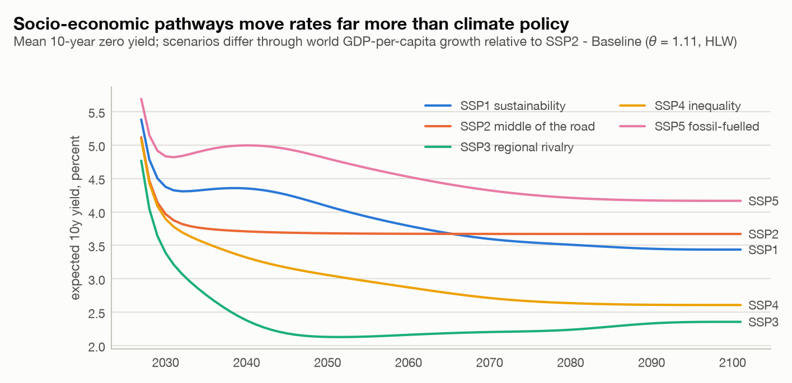
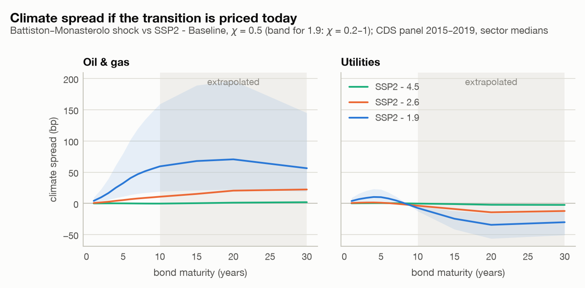
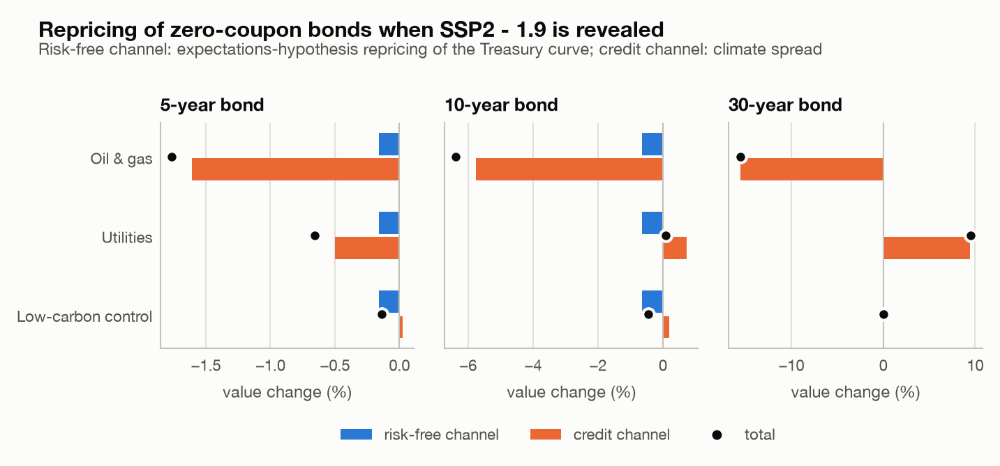
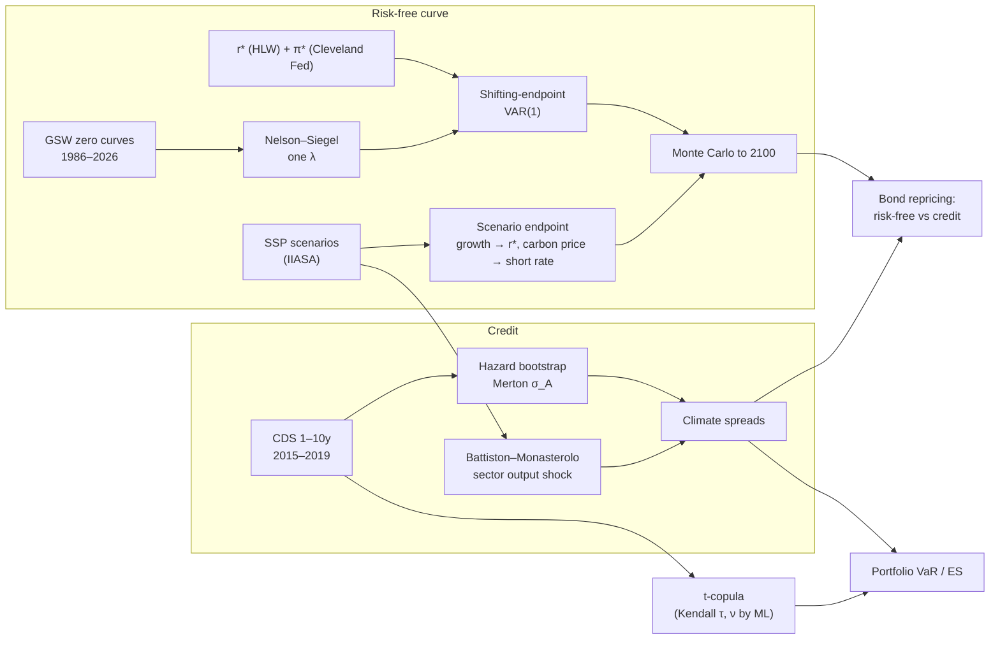

# Climate transition risk in the yield curve and in corporate credit spreads

[](https://github.com/pancakes9798/Climate-Risk-Project/actions/workflows/ci.yml)


This project projects the US Treasury yield curve and sector credit spreads to 2100 under the
Shared Socioeconomic Pathways (SSP). It asks how much of the climate-transition repricing of
corporate debt runs through the **risk-free curve** and how much through **credit spreads**.

> Capstone project of the Executive Master *Quantitative Methods for Climate Risk*, École
> Polytechnique. This is version 2, a full rebuild of the original notebooks: see the
> [changelog](CHANGELOG.md) for the audit of v0.1 and what changed. The original version is
> tagged [`v0.1-capstone`](https://github.com/pancakes9798/Climate-Risk-Project/tree/v0.1-capstone).

## Key findings

Numbers come from [`results/README.md`](results/README.md), generated by the pipeline.

1. **The socio-economic pathway matters far more for the risk-free curve than climate policy.**
   - By 2050 the expected 10-year yield ranges from 2.1% (SSP3) to 4.8% (SSP5), against 3.7%
     in the reference pathway.
   - The 1.5°C policy within SSP2 (SSP2-1.9) moves it by +10 bp in 2030 and −8 bp in 2050.
     Carbon pricing lifts short rates while the carbon bill catches up with the pathway's
     level, and slightly lower growth lowers r\*.
2. **Pricing the transition today widens oil & gas spreads; utilities can gain.**
   - Under SSP2-1.9 the 10-year climate spread is +59 bp for oil & gas producers: 19–159 bp
     across the plausible range of the asset-to-output elasticity.
   - It is −7 bp for utilities, whose low-carbon business grows with electrification.
   - It is −2 bp for the low-carbon control group, a pure risk-free (drift) effect.
   - The utility result depends on the integrated assessment model: +59 bp under IMAGE
     (SSP1-1.9) and +7 bp under REMIND (SSP5-1.9).
3. **Waiting is expensive.** If the same transition is priced only in 2035, the oil & gas
   10-year climate spread is 129 bp; if only in 2050, 222 bp. This is the "climate Minsky
   moment" of Battiston & Monasterolo.
4. **The yield-curve channel matters for every issuer, and its sign depends on the central
   bank.**
   - At revelation the 10-year Treasury yield reprices by +6 bp. This uses the expectations
     hypothesis, consistently with the projections.
   - That costs a 10-year bond 0.6%: about one tenth of the loss on an oil & gas bond (−6.4%),
     enough to cancel the small credit gain of utilities (+0.1% in total), and the whole loss
     on low-carbon bonds (−0.45% in total, as the higher drift lowers their default risk).
   - If the central bank looks through carbon-price inflation, the repricing is −4.5 bp
     instead; if the carbon bill catches up with the pathway by 2040 rather than 2050, +16 bp.
5. **Portfolio tail risk.** For an equally weighted portfolio of 65 issuers over five years,
   the 99% Expected Shortfall rises from 23.9% to 26.1% of notional under SSP2-1.9. This uses
   physical PDs and a t-copula calibrated on CDS co-movements (ν = 14.4). The relative
   increase, 9–13%, holds across dependence specifications, including the Basel IRB benchmark
   (12.5% → 14.2%).

Every assumption behind these numbers (θ, κ, χ, σ_A, the harmonisation convergence year) is
varied one at a time in the [sensitivity tables](results/README.md).

<picture>
  <source media="(prefers-color-scheme: dark)" srcset="results/figures/05_narratives_10y-dark.png">
  
</picture>

<picture>
  <source media="(prefers-color-scheme: dark)" srcset="results/figures/08_climate_spreads-dark.png">
  
</picture>

<picture>
  <source media="(prefers-color-scheme: dark)" srcset="results/figures/11_bond_value-dark.png">
  
</picture>

More figures (fit diagnostics, backtest, fan chart, delayed revelation, IAM uncertainty,
portfolio) are in [`results/figures/`](results/figures/).

## Method



**Risk-free curve.**
- **Factors.** Nelson–Siegel factors are estimated with one decay parameter (Diebold & Li,
  2006), on Gürkaynak–Sack–Wright zero-coupon yields.
- **Dynamics.** The level is split into the nominal natural rate i\* = r\* + π\* and a
  stationary cycle modelled by a VAR(1) (Bauer & Rudebusch, 2020).
- **Scenario channel.** Each scenario moves the endpoint through two channels:
  - its growth differential with the reference pathway, at the HLW elasticity θ = 1.113;
  - its carbon-price inflation impulse on the short rate, through the Taylor principle.
- **Expectations hypothesis.** Scenario effects enter yields as an expectations-hypothesis
  overlay of the scenario's short-rate path, used both in the projections and in bond
  repricing.
- **Harmonisation.** All scenarios are harmonised to the September 2026 jump-off.

**Credit.**
- **Baseline.** Risk-neutral default probabilities are bootstrapped from sector-median CDS
  curves.
- **Shock.** The Battiston & Monasterolo (2020) climate-policy shock maps sector output in the
  policy scenario, relative to the baseline of the same IAM, into a Merton default-threshold
  shift. The risk-free repricing $\Delta y$ moves the same threshold:
  $q_P = \Phi\big(\Phi^{-1}(q_B) - [\ln(1+\xi) + T\Delta y]/(\sigma_A\sqrt T)\big)$.

**Portfolio.**
- **Default dependence.** It comes from Kendall's τ of weekly CDS changes (ρ = sin(πτ/2)),
  with a t-copula whose ν is estimated by pseudo-maximum likelihood.
- **Measure.** Losses use physical PDs (Driessen, 2005, risk-premium ratio).

Every equation, parameter and source is in [`docs/methodology.md`](docs/methodology.md).

## Reproducing the results

```bash
git clone https://github.com/pancakes9798/Climate-Risk-Project.git
cd Climate-Risk-Project
uv sync                        # Python ≥ 3.11
uv run climate-risk download   # public data: GSW, HLW, Cleveland Fed, FRED
uv run climate-risk run        # → results/tables, results/figures, results/README.md
```

**Credit data.** The credit stage uses a licensed CDS panel that is not distributed (see
[`data/README.md`](data/README.md)). Without it the pipeline runs in **demo mode**: a flat
public Moody's Baa spread for every sector and Basel correlations. To reproduce the published
results:

```bash
CLIMATE_RISK_CDS_PATH=/path/to/cds.csv uv run climate-risk run
```

**Tests.** The suite runs offline on a synthetic data root:

```bash
uv run pytest --cov=climate_risk   # offline, ≥ 95% coverage
uv run ruff check . && uv run mypy
```

**Walkthrough.** [`notebooks/walkthrough.ipynb`](notebooks/walkthrough.ipynb) walks through
the pipeline step by step.

## Repository layout

```
src/climate_risk/
├── config.py            every parameter, with its source
├── data/                readers (GSW, HLW, FRED, OWID), versioned extracts, SSP interpolation
├── term_structure/      Nelson–Siegel, VAR, shifting endpoint, projection, backtest
├── credit/              CDS loading and bootstrap, Merton, transition shock, climate spreads
├── portfolio/           copulas, loss distributions, VaR/ES
├── pipeline/            the three stages and their result tables
├── figures/             light/dark figures (CVD-validated palette)
├── report.py            results/README.md generator
└── cli.py               climate-risk {download, run, info}
data/                    processed extracts, SSP table, sector map (CDS panel never committed)
docs/methodology.md      equations, identification, calibration, limitations
results/                 tables (CSV), figures (PNG), generated summary
tests/                   unit and end-to-end tests on synthetic data
```

## Limitations

- The SSP quantifications date from 2017 and are world-level. NGFS scenarios are the natural
  next step.
- The Nelson–Siegel model is not arbitrage-free. Term premia are held constant.
- The transition shock uses static business lines: no capex reallocation, and a representative
  utility.
- Physical risk is out of scope. PG&E, the original case study, went bankrupt in 2019 because
  of wildfire liabilities.

The full discussion is in [`docs/methodology.md` §7](docs/methodology.md#7-limitations-and-extensions).

## References

Key sources:
- Diebold & Li (2006);
- Gürkaynak, Sack & Wright (2007);
- Bauer & Rudebusch (2020);
- Holston, Laubach & Williams (2023);
- Riahi et al. (2017);
- Battiston & Monasterolo (2020);
- Merton (1974);
- Demarta & McNeil (2005);
- Driessen (2005).

The complete list is in [`references/references.bib`](references/references.bib).

## Citation and author

Emanuele Migliaccio, PhD candidate in Quantitative Finance, Sapienza University of Rome. The
credit-spread notebook of v0.1 was co-authored with Marco Venditti. To cite this repository,
see [`CITATION.cff`](CITATION.cff). The code is released under the [MIT licence](LICENSE); data
sources keep their own terms.
